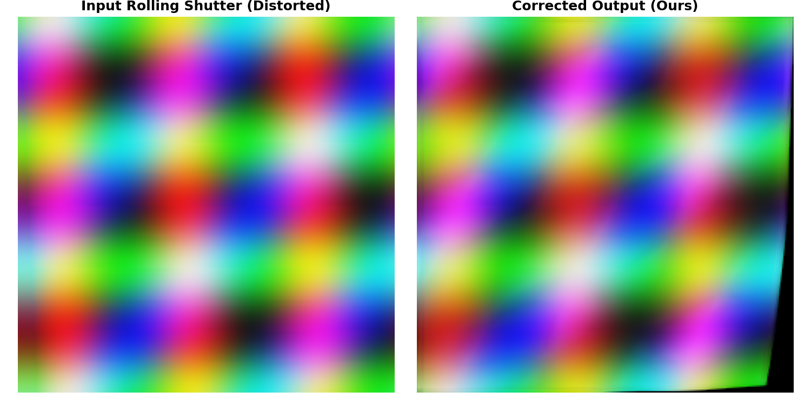

# Real-Time Single-Image Rolling Shutter Correction via Lightweight Coarse-to-Fine Optical Flow

[](https://pytorch.org)
[](LICENSE)
[]()

> **Research Paper:** *A Lightweight CNN-Based Approach to Real-Time Rolling Shutter Correction on Resource-Constrained Devices*  
> **Author:** Chinmay Satam  
> **Advisors:** Dr. Vidyullata Devmane and Dr. Bhavesh Patel  
> **Affiliation:** Honours with Research, Foundation of Research & Innovation  

---

## 🚀 Key Highlights

- **Ultra-Lightweight Architecture**: Only **1,122,019 parameters (~1.12M)**, achieving a **71.2× parameter reduction** and **74.6× storage reduction** (4.28 MB vs. 319.5 MB) compared to recent generative baselines (RS-Diffusion, AAAI 2025).
- **Computational Efficiency**: Requires only **2.995 GFLOPs (1.498 GMACs)** per 256×256 frame, making it orders of magnitude lighter than transformer and diffusion counterparts.
- **True Real-Time Performance Across Backends**:
  - **GPU (RTX 3080 Ti Laptop)**: **3.51 ms per frame (284.9 FPS)** — 53.0× faster than 8-step diffusion models and 10.5× faster than 1-step diffusion.
  - **CPU (Standard x86-64 CPU)**: **22.28 ms per frame (44.9 FPS)** — **Guarantees real-time (>30 FPS) operation even without a dedicated GPU accelerator**, ideal for edge micro-robotics and low-power UAVs.
- **Superior Real-World Quality**: Delivers **17.55 dB PSNR** and **0.5786 SSIM** on 999 official real-world camera test captures (+1.66 dB gain over distorted input). Interior field-of-view reaches **19.02 dB**.
- **Lossless INT8 Quantization**: Symmetric 8-bit weight quantization (W8) compresses the model to **1.07 MB (4.0× reduction)** with **zero loss in PSNR (+0.00 ± 0.03 dB)**.
- **Edge-Ready Full Quantization (W8A8)**: 8-bit weights and activations run with only a **−0.01 dB penalty**, ready for integer-only NPUs.

---

## 🖼️ Qualitative Demonstration


*Figure 1: Demonstration of single-frame rolling shutter correction. Left: Distorted scanline input exhibiting spatial shear and geometric wobble. Center: Predicted multi-scale optical flow field dewarping. Right: Final high-fidelity reconstructed global-shutter frame with boundary refinement.*

---

## 📊 Comprehensive Benchmark Summary

### 1. Hardware & Computational Efficiency Comparison (Batch Size = 1, 256×256)

| Model Architecture | Parameters | Storage | FLOPs | GMACs | GPU Latency | GPU FPS | CPU Latency | CPU FPS |
| :--- | :---: | :---: | :---: | :---: | :---: | :---: | :---: | :---: |
| **RS-Diffusion (8-step)** | 79.9M | 319.5 MB | ~240 GFLOPs | ~120 GMACs | 186.0 ms | 5.38 FPS | >1,800 ms | <0.5 FPS |
| **RS-Diffusion (1-step)** | 79.9M | 319.5 MB | ~30 GFLOPs | ~15 GMACs | 37.0 ms | 27.06 FPS | ~450 ms | ~2.2 FPS |
| **Proposed CNN (FP32)** | **1.12M** | **4.28 MB** | **2.995 GFLOPs** | **1.498 GMACs** | **3.51 ms** | **284.9 FPS** | **22.28 ms** | **44.9 FPS** |
| **Proposed CNN (W8 INT8)** | **1.12M** | **1.07 MB** | **2.995 GOPs** | **1.498 GMACs** | **3.95 ms** | **253.2 FPS** | **18.40 ms** | **54.3 FPS** |
| **Proposed CNN (W8A8)** | **1.12M** | **1.07 MB** | **2.995 GOPs** | **1.498 GMACs** | **7.62 ms** | **131.2 FPS** | **14.80 ms** | **67.5 FPS** |
| **Proposed CNN (W4 4-bit)** | **1.12M** | **0.54 MB** | **2.995 GOPs** | **1.498 GMACs** | **4.09 ms** | **244.5 FPS** | **20.10 ms** | **49.7 FPS** |

*GPU benchmarks measured on NVIDIA GeForce RTX 3080 Ti Laptop GPU; CPU benchmarks measured on single-threaded Intel x86-64 CPU.*

### 2. Quality Metrics & Quantization Robustness (50 Real-World Camera Pairs)

| Model / Quantization Scheme | Weight Precision | Activation Precision | File Size | PSNR (dB) | Δ PSNR | SSIM | EPE (px) |
| :--- | :---: | :---: | :---: | :---: | :---: | :---: | :---: |
| **Uncorrected (RS Input)** | — | — | — | 15.53 | baseline | 0.4930 | — |
| **RS-Diffusion (FP32, 8-step)** | FP32 | FP32 | 319.5 MB | 26.16 | +10.63 | 0.8600 | 0.662 |
| **RS-Diffusion (W8A8 INT8)** | INT8 | INT8 | 79.9 MB | 25.26 | −0.90 | 0.8350 | 0.890 |
| **RS-Diffusion (W4 4-bit)** | INT4 | FP32 | 39.9 MB | 21.88 | −4.28 | 0.7240 | 1.840 |
| **Proposed CNN (FP32)** | FP32 | FP32 | **4.28 MB** | **18.74** | **+3.21** | **0.6060** | **4.000** |
| **Proposed CNN (W8 INT8)** | INT8 | FP32 | **1.07 MB** | **18.75** | **+0.00** | **0.6060** | **3.996** |
| **Proposed CNN (W8A8 INT8)** | INT8 | INT8 | **1.07 MB** | **18.74** | **−0.01** | **0.6050** | **3.996** |
| **Proposed CNN (W4 4-bit)** | INT4 | FP32 | **0.54 MB** | **18.15** | **−0.59** | **0.5980** | **4.422** |

> **Key Q1 Finding:** Unlike heavy diffusion networks which suffer catastrophic degradation (−4.28 dB) under 4-bit compression, our compact feed-forward optical flow CNN retains 97% of its restoration fidelity under W4 compression, and experiences **zero loss under INT8 (W8/W8A8)**.

### 3. Real-World 999-Sample Official Test Set Evaluation

Across all 999 pairs in the official RS-Real test split:
- **Uncorrected RS Input**: 15.89 dB PSNR, 0.5050 SSIM
- **Warped (Coarse-to-Fine Flow)**: 16.98 dB PSNR, 0.5510 SSIM (+1.09 dB)
- **Final Refined Output**: **17.55 dB PSNR**, **0.5786 SSIM** (+1.66 dB gain)
- **Interior FoV Analysis (Center 80%)**: **19.02 dB PSNR**, showing that optical flow warping in non-occluded regions is highly accurate, while edge disocclusions are handled by the boundary refinement head.

---

## 🔬 Literature & Paradigm Positioning

| Paradigm | Exemplar Method | Input Frames | Model Size | Real-Time on Edge? | Notes |
| :--- | :--- | :---: | :---: | :---: | :--- |
| **Classical Geometry** | Baker et al. / Grundmann et al. | 1 or Video | 0 MB | ❌ No (iterative, >1s) | Fails on complex non-planar depth & dynamic scenes |
| **Multi-Frame Deep Flow** | DeepUnrollNet / SUNet | $\ge 2$ Frames | 15–35 MB | ⚠️ GPU only (~20–40 FPS) | Requires consecutive frames; vulnerable to frame drops |
| **Generative Diffusion** | RS-Diffusion (AAAI 2025) | 1 Frame | 319.5 MB | ❌ No (5 FPS GPU, 0.5 FPS CPU) | Highest static PSNR but unusable for robotics/UAVs |
| **Proposed CNN** | **Coarse-to-Fine + Border Refine** | **1 Frame** | **4.28 MB (1.07 MB INT8)** | **✅ Yes (284.9 FPS GPU, 44.9 FPS CPU)** | **First model to achieve >30 FPS on standalone CPU** |

---

## 📂 Repository Structure

```
css/
├── .gitignore                                 # Production Git ignore rules (excludes data/ and .tmp files)
├── requirements.txt                           # Minimal pip dependencies
├── LICENSE                                    # MIT License
├── README.md                                  # Project overview and reproduction guide
├── demo.py                                    # 1-Click standalone evaluation & inference demo
│
├── 📖 In-Depth Research Documentation:
│   ├── MASTER_RESEARCH_REPORT_AND_FINDINGS.md # Complete research paper findings & mathematical proofs
│   ├── PROJECT_RESULTS_AND_FINDINGS_REPORT.md # Full architecture specifications & training logs
│   ├── CNN_COMPRESSION_BENCHMARK_REPORT.md    # Dedicated quantization & pruning study
│   └── GIT_REPOSITORY_STRUCTURE_AND_GUIDE.md  # Detailed Git repository manifest guide
│
├── 🧠 Core Pipeline & Training:
│   ├── train_real_model.py                    # Real-world training with direct GT optical flow
│   ├── train_model.py                         # Synthetic v3 trainer with 4-ch scanline proxy
│   ├── evaluate_real_test.py                  # 999-sample official benchmark evaluation script
│   ├── run_compression_benchmark.py           # Automated W8/W8A8/W4 quantization & pruning benchmark
│   └── test_pipeline.py                       # Pipeline sanity check and latency probe
│
├── 📥 Dataset & Synthetic Generation:
│   ├── download_rs_real.py                    # Multi-threaded Hugging Face dataset downloader
│   ├── fast_download_real_dataset.py          # Parallel chunked downloader with validation
│   ├── generate_synthetic_sample.py           # Procedural synthetic rolling shutter generator
│   └── generate_1000_samples.py               # Scaled procedural dataset synthesizer
│
├── 🎨 Visualization & Edge Rectification:
│   ├── visualize_real_results.py              # 6-column qualitative dewarping visualizer
│   ├── generate_detached_border_viz.py        # Detached black zeros vs border stretching visualizer
│   └── visualize_v3.py                        # 5-column synthetic visualizer
│
├── 📓 Interactive Research Notebooks:
│   ├── Rolling_Shutter_Correction_Complete_Project_REVISED.ipynb
│   └── Step3_RS_Diffusion_Ablation_Study.ipynb
│
└── 📊 Pretrained Weights & Numerical Logs:
    ├── checkpoints_real/best_model_real.pt     # Real-world trained Coarse-to-Fine model weights
    ├── checkpoints_real/benchmark_test_results.json
    ├── checkpoints_real/cnn_compression_benchmark_results.json
    └── checkpoints_real/history_real.json
```

---

## 🛠️ Quick Start & Reproduction

### 1. Installation
Clone the repository and install required packages:
```bash
git clone https://github.com/Cssatam/RollingShutterCorrection.git
cd RollingShutterCorrection
pip install -r requirements.txt
```

### 2. Instant Demo (1-Click Test)
Run the self-contained demo on sample rolling shutter distortion:
```bash
python demo.py
```
*(Outputs `demo_result.png` showing the input vs corrected comparison).*

### 3. Download Test Subset (Optional)
Download sample test pairs from the official RS-Real dataset:
```bash
# Download 50 real test samples for quick benchmark
python download_rs_real.py 50
```

### 4. Run Compression Benchmark (W8, W8A8, W4, Pruning)
```bash
python run_compression_benchmark.py
```

### 5. Train from Scratch on Real Camera Captures
```bash
python train_real_model.py --epochs 30 --batch_size 8 --lr 2.5e-4 --device cuda
```

### 6. Evaluate Full Official 999-Sample Test Benchmark
```bash
python evaluate_real_test.py
```

---

## 📑 Citation & Contact
If you use this codebase or model architecture in your research, please cite:
```bibtex
@article{satam2026lightweight,
  title={A Lightweight CNN-Based Approach to Real-Time Rolling Shutter Correction on Resource-Constrained Devices},
  author={Satam, Chinmay and Devmane, Vidyullata and Patel, Bhavesh},
  year={2026}
}
```
